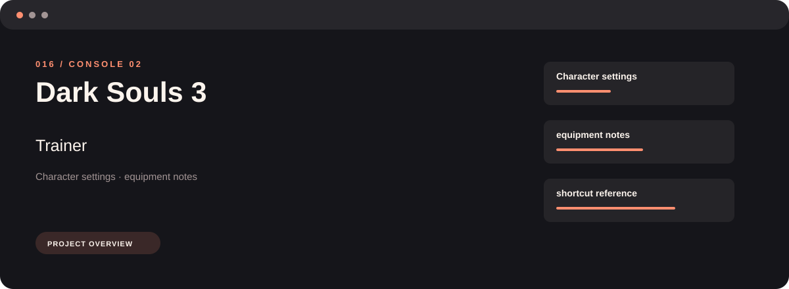
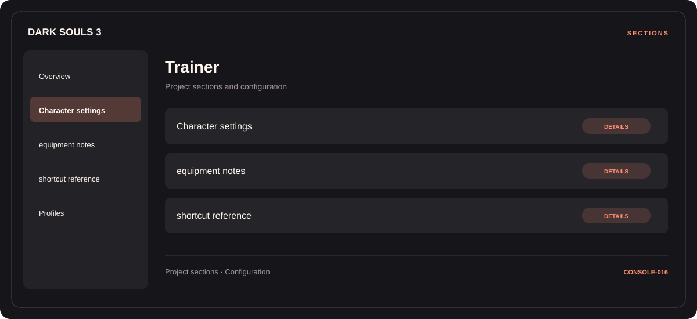

# 🛠️ Dark Souls 3 Trainer

**Character settings · Equipment notes · Shortcut reference**

## ⚡ Features

Start with character settings, organize equipment notes, and keep shortcut reference close at hand. These are the main areas covered by Dark Souls 3 Trainer.

### ⚙️ Character settings

Character-related parameters and the settings associated with the selected category.

### 🧩 Equipment notes

Equipment categories and the associated selection or configuration options.

### ⌨️ Shortcut reference

Shortcut assignments and control mappings, organized in one reference section.

## 🖥️ Project navigation

## 📥 Download

The button and cover open the project's download page. Use the information supplied with the downloaded package for installation and release-specific requirements.

## 📚 Project documentation

- [Feature reference](docs/FEATURES.md)
- [Download information](docs/DOWNLOAD.md)
- [Project page](index.html)

---

Dark Souls 3 Trainer · Program documentation and download information.
                                                                                                    